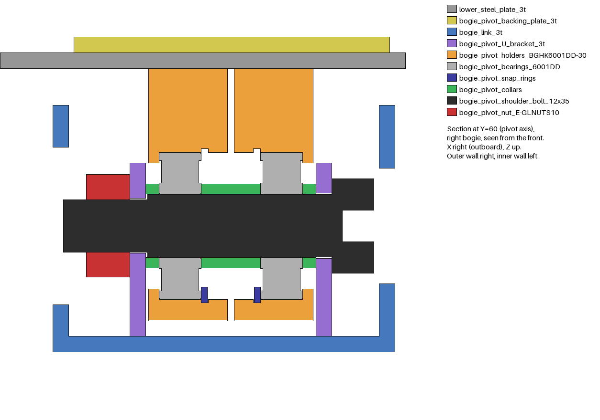

# 보기 링크 서스펜션 · Rev16 (앞 캐스터 + 구동륜, 베어링 피벗)

상태: **Rev16 설계·모델링 완료, 실물 미검증** (2026-11-15). Rev15의 무급유 부시(EA-MFCNW20) 피벗을, 사용자 요청대로 회사 재고 **BGHK6001DD-30 베어링 홀더 + 숄더 볼트 + M10 록너트 + 칼라** 피벗으로 바꿨다. 링크 본체, 스토퍼, 뒤 캐스터는 Rev15와 같다. Rev14(6륜 독립 경첩)는 `layout.json`의 `suspension.concept`를 `"hinge"`로 바꾸면 다시 만들 수 있다.

## 구조

좌우 각각 구동륜(Y0)과 앞 캐스터(Y+215)를 3t 절곡 보기 링크 하나에 단다. 링크는 좌우 방향(X) 축을 중심으로 시소처럼 돈다. 뒤 캐스터 2개는 Rev14 경첩 + 스프링 모듈을 그대로 쓴다.

| 부품 | 내용 |
|---|---|
| 보기 링크 | S355 3t 레이저 절단 + 절곡 4회, 용접 없음. 바깥벽(X170~173) = 구동축 벽(AF10.2 슬롯). 뒤 바닥(Z63~66, Y−40~150) + 뒤 안쪽벽(X108~111). 앞 캐스터 패드(Z83~86, Y160~252.5) + 앞 안쪽벽. 피벗 축 위치에 바깥벽 Ø22(볼트 삽입·육각렌치), 안쪽벽 Ø30(너트 소켓) 구멍 |
| 안쪽벽 이음판 | 3t 평판. 뒤·앞 안쪽벽은 서로 다른 날개에서 나오므로 CB5-12 4개로 잇는다 |
| 베어링 홀더 | **BGHK6001DD-30 2개/쪽**(회사 재고 4개). T형, 6001DD 베어링(내경 12), 중심 높이 30. 하판 밑에 플랜지를 위로 거꾸로 달고 M5(CB5-22) 2개씩 조인다. 2mm 턱 쪽(베어링이 바깥면에서 2mm)이 바깥을 보게 마주 놓아 베어링 간격을 최대로 했다. 사용자가 준 MISUMI STEP을 그대로 배치했다 |
| 백킹판 | 3t 평판(절곡 없음), 하판 위 X112~172·Y30~90.5. 홀더 볼트가 함께 조여 두 홀더의 짝힘을 하판에 넓게 나눈다 |
| 피벗 축 | **숄더 볼트 BN1359 12×35**(회사 재고 2개, M10). 바깥에서 넣어 두 베어링을 지나고, 링크 바닥의 U 브래킷 두 귀를 관통한다. 머리는 바깥 귀, **E-GLNUTS10** 록너트(회사 재고)는 안쪽 귀를 조인다 |
| 칼라 | d12.1×D16, 길이 2.5 / 11.3 / 2.5 (3개/쪽, 구매품). 칼라 묶음이 어깨보다 0.3mm 길어서 너트가 귀·칼라·내륜을 함께 조인다(내륜 고정, 어깨 끝은 닿지 않음) |
| U 브래킷 | 3t 절곡 2회. 링크 뒤 바닥 위에 CB5-12 4개로 고정. 홀더 몸체 아래가 비도록 바닥판에 창을 냈다. 귀 구멍 Ø12.2(머리 쪽) / Ø10.5(너트 쪽) |
| 피벗 위치 | Y+60, Z87(하판 밑면 117 − 홀더 중심 높이 30). 베어링 중심 X151.5 / X132.2, 간격 19.3mm |
| 회전 제한 | 뒤 바닥 위 C-USLH10 2개(회사 재고), 하판에서 내려온 M6 스트라이커가 받는다. 앞 캐스터 ±10mm에서 닿고, 잼너트로 조정한다 |
| 구동축 | 6t 평판 토크판(AF10.2 슬롯) + 바깥벽. 와셔·M14 너트로 함께 조인다. 바깥쪽 4.9 시험 스페이서는 Rev14와 같다 |
| 앞 캐스터 | GL-65 판(2t) 밑에서 CB6-12를 넣고 패드 위 M6 너트로 조인다(Rev14 방식) |
| 뒤 캐스터 | Rev14 경첩 모듈. 예압 심 3mm |
| 모터 케이블 | 하판 X±154·Y5에 Ø28 구멍 + 고무 그로밋. 허브 모터 선은 축 안쪽 끝에서 나와 링크 안을 지나 이 구멍으로 올라가 모터 드라이버로 간다. 구동륜 ±3.9mm 움직임만큼 여유를 둔다(배선 경로는 모델에 없음) |

조립 순서: 링크에 U 브래킷을 붙이고, 홀더 2개를 귀 사이에 놓은 채 볼트를 바깥벽 구멍으로 넣어 칼라·홀더를 꿰고 너트를 조인다(바퀴를 달기 전, 머리는 6mm 육각렌치로 잡고 너트는 안쪽벽 구멍으로 소켓). 그다음 이 묶음을 하판 밑에 대고 홀더 볼트 4개를 조인다. 록너트 카탈로그 토크는 31N·m지만, 칼라·내륜 면압(약 175MPa)을 고려해 20N·m 정도로 시작하기를 권한다.

## 바뀐 배치 (Rev16)

- 배터리 Y−35 → **Y−49**: 안쪽 홀더 볼트(X133.7, Y36) 머리가 배터리 밑면과 겹쳐 14mm 뒤로 옮겼다. 뒤쪽 전원 분배 예약 공간과 약 4mm 남는다. 무게중심 이동은 약 1mm라 하중 분배에 영향이 거의 없다.
- 모터 드라이버 Y125 → **Y145**: 드라이버 스탠드오프가 바깥 홀더 볼트·백킹판과 겹쳐 앞으로 옮겼다.

## 하중 (단순 정적, 55kg, 무게중심 중앙 가정)

| 항목 | 값 |
|---|---|
| 피벗 하중 | 한쪽 약 211N |
| 구동륜 | 한쪽 약 152N, 전체 하중의 **56%** |
| 앞 캐스터 / 뒤 캐스터 | 각 약 59N |
| 무게중심 ±30mm | 구동륜 비율 49~64%, 뒤 캐스터 29~88N |
| 보기 행정 | 앞 캐스터 ±10mm일 때 구동륜 ∓3.9mm |
| 앞으로 기우는 시작점 | 감속 약 0.3g(무게중심 높이 200mm 가정) |

## 베어링 피벗 점검 (단순 정적, 수직 하중만)

구동륜(X211)이 베어링 쌍보다 바깥에 있어 피벗에 롤 모멘트(중앙 무게중심에서 약 10.3N·m)가 걸린다. 두 베어링 간격이 19.3mm라 바깥 베어링이 하중 대부분을 받고, 안쪽 베어링은 반대 방향으로 당겨진다.

| 경우 | 바깥 / 안쪽 베어링 | 정적 안전계수 s0 (C0r 2.39kN) 1g / 2g / 3g |
|---|---|---|
| 무게중심 중앙 | 638N / −427N | 3.7 / 1.9 / **1.25** |
| 무게중심 뒤 30mm | 549N / −368N | 4.4 / 2.2 / 1.45 |
| 무게중심 앞 30mm | 727N / −487N | 3.3 / 1.6 / **1.1** |

- 평상 주행(1g)은 여유가 있다. 3g 수직 충격(턱에서 떨어짐)에서는 s0가 1.1~1.25로, 충격 하중에 흔히 권하는 1.5~2보다 낮다. 실내 저속 AMR에서 3g가 실제로 생기는지는 시제품에서 확인해야 한다.
- 더 키우려면: 실제 숄더 볼트가 더 길면(예: 12×40) 가운데 칼라를 늘려 간격을 넓힌다. 간격 24mm(어깨 40)면 3g s0가 약 1.4가 된다.
- 숄더 볼트 굽힘(두 귀 사이 단순 지지): 정지 약 19MPa, 3g 약 56MPa.
- U 브래킷 귀 지압: 3g 약 33MPa. 안쪽 홀더 볼트 인장: 3g 볼트당 약 640N.
- 하판 국부 굽힘: 짝힘을 백킹판 폭(60mm)으로 나누면 하판에 전달되는 힘은 정지 약 170N, 3g 약 510N이다. 하판 실제 강성과 응력은 계산하지 않았다.
- 피로, 미동 마모(작은 각도 왕복), 옆방향 힘(회전·충돌), 베어링 수명은 검증하지 않았다.

## 강도 (링크 본체, Rev15 계산 유지, 3g 수직, S355)

| 위치 | 값 |
|---|---|
| 링크 굽힘(피벗 단면) | 약 8MPa |
| 구동륜 편심 비틀림(축~피벗, 열린 U 단면) | 정지 약 31MPa / 3g 약 92MPa, 정지 비틀림각 약 0.44° |

구동륜 캠버가 바뀌는 비틀림(정지 0.44°)은 시제품에서 재고, 크면 축과 피벗 사이에 볼트 체결 칸막이판을 추가한다.

## 회사 재고 부품 검토

| 부품(수량) | 사용 | 이유 |
|---|---|---|
| BGHK6001DD-30 (4) | **피벗 베어링 홀더 4개** | 좌우 2개씩, 하판 밑에 매단다 |
| SHOULDER BOLT BN1359 12×35 (2) | **피벗 축 2개** | 리스트 길이 35를 기준으로 설계했다. 받은 STEP은 어깨 30.0mm라 **실물 확인 필요**: 30이면 칼라 묶음(35.3)이 들어가지 않는다. 모델은 ISO 7379 카탈로그 치수로 만들었다 |
| E-GLNUTS10 (4) | **2개 사용**(2개 예비) | M10 링 록너트(맞변 17, 높이 8.3) |
| C-USLH10 (10) | **6개 사용** | 보기 회전 제한 4 + 뒤 캐스터 범프 스토퍼 2 |
| EA-MFCNW20 (2) | 사용 안 함(Rev16) | 피벗을 베어링 방식으로 바꿨다 |
| MFINS20 (2) | 사용 안 함 | 맞는 축이 없다 |
| SM27X50 (6) | 사용 안 함 | 금형 스프링 89N/mm라 바퀴 하중 60~150N에 비해 너무 단단하다 |
| E-SHCCG6-73/75 (각 6), C-WSSA20-6-5 (4) | 사용 안 함 | Ø6 핀용. 맞는 Ø6 부시가 재고에 없다 |
| DDR-240B-24 (1) | 후방 우측 크기 예약 | 데이터시트 치수와 입력 범위(7S 21~29.4V)를 확인해야 한다 |

## 가격 (서스펜션 전체, VAT 별도)

MISUMI 가격 62,548원 + 추정 252,700원 = **315,248원**(Rev15 336,088원보다 20,840원 적음). Ø20 축, 스러스트 와셔, 8t 보강판, CB5-20/16, CB8-16이 빠지고 칼라 6개, 바닥 U 브래킷, 3t 백킹판, CB5-22, 그로밋이 들어갔다. 회사 재고(BGHK 4, 숄더 볼트 2, 록너트 2, C-USLH10 6)는 0원이다. 절곡·레이저 부품 가격은 견적 전 추정이다. 원본: [bom/suspension_misumi.csv](../bom/suspension_misumi.csv).

## 전장 배치

- 배터리: 회사 7S9P STEP을 Y−49 중앙, 3mm 고무 패드 위에 놓았다. 단자 위끝 Z237.8로 LiDAR 스캔면(240.8)보다 낮다. 고정 스트랩은 아직 정하지 않았다.
- LCD: 회사 7인치 STEP을 전면 중앙(앞끝 Y262)에 15° 위로 기울여 놓았다. 3t 절곡 브래킷과 출력 측면 클램프 2개로 잡는다.
- 스피커: 회사 스피커 박스 STEP을 후방 좌측에 그릴이 뒤(−Y)를 향하게 놓았다. 3t 절곡 브래킷에 M3 3개로 단다.
- 모터 드라이버(크기 예약): X±124, Y145. 모터 케이블 구멍(Y5)에서 하판 위로 약 90mm 앞에 있다.
- DC/DC: 후방 우측 DIN 레일 위 크기 예약.

## 검증

검증 수치는 `design_state.md`의 Rev16 항목을 본다. 검증하지 않은 것: 강도(단순 계산만), 연속 스윕 간섭, 실물 치수(숄더 볼트 길이 미확인, 칼라는 카탈로그 외형), 배선 경로.

## 남은 일

1. **숄더 볼트 실제 어깨 길이(30 또는 35)를 잰다.** 30이면 이 피벗이 성립하지 않는다.
2. 칼라 형번을 정한다(d12.1×D16, 길이 2.5/11.3/2.5, 외경은 내륜 턱 Ø16.3 이하).
3. 시제품에서 피벗 유격·베어링 소음, 비틀림각, 스토퍼 간격, 뒤 캐스터 심 두께를 확인한다.
4. 모터 케이블 경로·고정, 배터리 고정, LCD 인터페이스, 스피커 앰프, DC/DC 데이터시트를 확인한다.

## 이력

- 2026-11-14 준비 문서: 사용자가 보유 부품을 제공하기 전 기준값과 질문을 정리했다(git 기록).
- 2026-11-15 Rev15: 회사 재고 리스트와 STEP을 반영해 EA-MFCNW20 무급유 부시 + Ø20 축 피벗으로 설계했다(커밋 `e7f6338`).
- 2026-11-15 Rev16: 사용자 결정으로 피벗을 BGHK6001DD-30 + 숄더 볼트 + E-GLNUTS10 + 칼라로 바꾸고, 모터 케이블 구멍을 추가했다. 같은 날 사용자가 준 BGHK6001DD-30 STEP(플랜지 10, 턱 Ø24×2, 스냅링 입구 Ø28×5)으로 카탈로그 표 모델을 바꿨다.
- Rev10 시소 개념은 커밋 `a5f5081`에 있다.
